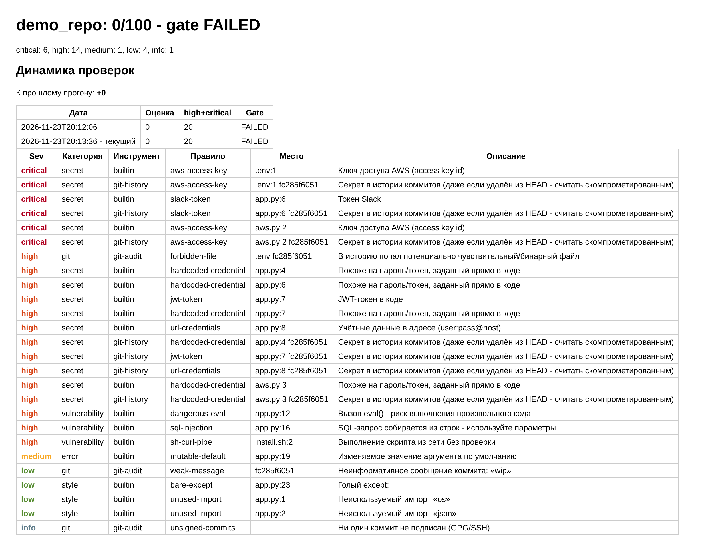

# CodeAudit — локальный конвейер анализа качества кода и аудита Git-репозиториев

Тема проекта МО-1: автоматизация анализа качества исходного кода и аудита Git-репозиториев
в импортонезависимой среде. Одна офлайн-утилита проверяет и код, и историю коммитов,
ставит оценку 0–100 и решает, пройден ли quality gate.


Скриншот HTML-отчёта по демо-репозиторию (`python3 run_demo.py`):



## Быстрый старт

Подробная пошаговая инструкция для первого запуска — в [ЗАПУСК.md](ЗАПУСК.md).
Единая точка входа — меню (демо, проверка своего репозитория, правка порогов, справка):

```
python3 run.py          # Windows: run.bat (двойной клик, затем пункты меню)
```

Проверка одной командой без меню: `python3 run_demo.py` (создаёт демо-репозиторий
с дефектами и проверяет его). Требования: Python 3.11+ и git. Больше ничего:
pip-зависимости не нужны, сеть не используется.

## Как выглядит запуск (реальный вывод демо)

```
[..] builtin-python: работаю...
[ok] builtin-python: 3
[..] builtin-lint: работаю...
[ok] builtin-lint: 3
[..] builtin-patterns: работаю...
[ok] builtin-patterns: 1
[..] builtin-style: работаю...
[ok] builtin-style: 0
[..] builtin-secrets: работаю...
[ok] builtin-secrets: 9
[..] git-audit: работаю...
  ... git-audit: в истории 1 коммитов
  ... git-audit: оцениваю размеры объектов истории
  ... git-audit: сканирую патчи всей истории на секреты
[ok] git-audit: 10
Оценка 0/100, high+critical=20, gate=FAILED; отчёты: demo_out/
Готово за 0.0 с
```

По каждой стадии видно, где конвейер: `[..]` — работает, `[ok]` — готово,
`[--]` — пропущено (внешний инструмент не установлен), `[!!]` — ошибка стадии
(не роняет конвейер, подробно в отчёте). Внешние инструменты (`ruff`, `bandit`,
`semgrep`, `gitleaks`, `shellcheck`) на этой машине не установлены — конвейер
отработал целиком на встроенных проверках.

## Что проверяет

```
репозиторий ─► [1 ошибки] ─► [2 уязвимости] ─► [3 стиль/линтер] ─► [4 секреты] ─► [5 история Git]
                    │              │                  │                 │                │
                    └──────────────┴── единый список находок (Finding) ──┴────────────────┘
                                         │ дедупликация, оценка 0-100
                                         ▼
                      report.json / report.md / report.html + quality gate (код возврата 0/1)
```

| Стадия | Внешний инструмент (если есть) | Встроенная реализация |
|---|---|---|
| Ошибки | ruff (F, B, E9) | синтаксис через `ast`, изменяемые аргументы по умолчанию, assert на кортеже, переопределённые функции |
| Уязвимости | bandit, semgrep (локальные правила) | eval/exec, shell=True, SQL-инъекции, pickle/yaml.load, слабые хеши, отключённый TLS, debug; правила для JS/TS, C/C++, PHP, Java, shell |
| Стиль (линтер) | ruff (E, W, N, C90), shellcheck | неиспользуемые и `*`-импорты, сложность, длина функций и строк, имена, сравнение с None, пробелы, EOF, отступы, TODO |
| Секреты | gitleaks | 11 видов секретов (см. ниже) |
| История Git | gitleaks | секреты во всех коммитах (включая удалённые), запрещённые файлы, крупные объекты, массивные коммиты, слабые сообщения, даты из будущего, неподписанные коммиты, подозрительные авторы |

Детектор секретов находит 11 видов: ключи AWS (access и secret), приватные ключи,
токены GitHub, ключи Google API, ключи Stripe, токены Slack, токены ботов Telegram,
JWT-токены, учётные данные в адресе (`user:pass@host`) и пароли/токены, заданные прямо в коде.

## Что под капотом

- **Прогресс на каждом шаге.** Стадии печатают `[..] / [ok] / [--] / [!!]`; при больших
  репозиториях — счётчик просмотренных файлов каждые 5000 (в stderr, чтобы stdout
  оставался машиночитаемым); в конце — время анализа.
- **Кэш сканирования.** Хэши всех файлов, включая файлы без находок, хранятся в
  `.scan_cache.json` внутри папки отчёта; повторный прогон повторно использует
  результаты неизменённых файлов. Кэш сбрасывается при изменении конфигурации или
  кода анализаторов; отключается флагом `--no-cache`.
- **История проверок.** Каждый прогон дописывает строку в `history.jsonl` (в папке
  отчёта); в отчётах появляется раздел «Динамика проверок» — оценка, high+critical
  и вердикт gate по прогонам, с дельтой к прошлому разу.
- **Каждая стадия независима:** сбой одной не останавливает конвейер, но неполный
  скан не проходит gate. В отчёте будет `scan_complete: false`, а код возврата — 1.
  Некорректный конфиг останавливает запуск с кодом 2.
- **Единые файловые фильтры.** `scan.exclude_dirs` и `scan.max_file_kb` применяются
  к встроенным проверкам, Ruff, Bandit, Semgrep и ShellCheck. Gitleaks получает
  исключения для путей Git-истории и ограничение размера в целых МБ (минимум 1 МБ).
- **Модули проекта.** `codeaudit/` содержит конфигурацию, сканеры, кэш, Git-аудит,
  отчёты и общие типы; `pipeline.py` остаётся точкой входа.

Импортонезависимость: все компоненты открытые; при `offline = true` конвейер не обращается
в сеть (semgrep использует только каталог `semgrep-rules`, режим `auto` запрещён).
Платформы CI: Gitea, GitLab CE, Forgejo, GitVerse.

## Оценка и quality gate

Оценка репозитория: `100 - сумма весов находок` (info 0, low 1, medium 3, high 8, critical 20),
не ниже 0. Gate пройден, если число high+critical не больше `gate.max_high` и оценка не ниже
`gate.min_score`. Пороги и остальные настройки — в `config.toml` (править можно прямо в файле
или через пункт 3 меню).

## Использование

```
python3 run.py                                                        # меню: демо / свой репозиторий / пороги
python3 pipeline.py /путь/к/репо --out report --config config.toml     # код возврата 1, если gate не пройден
python3 pipeline.py /путь/к/репо --out report --no-cache               # то же без переиспользования кэша
docker build -t codeaudit . && docker run --rm -v $PWD:/repo -v $PWD/report:/report codeaudit
cp pre-push-hook.sh .git/hooks/pre-push && chmod +x .git/hooks/pre-push   # проверка перед push
```

CI: `.gitea-ci.yml` (запуск на push и pull request, нужна полная история `fetch-depth: 0`).

## Методика оценки (бенчмарк)

Скрипт `bench/bench.py` генерирует репозитории с заранее известными дефектами (21 тип в коде
и 5 типов в истории Git), запускает конвейер и сравнивает найденные пары (правило, файл)
с «истиной»: TP — найдено и внедрено, FP — найдено, но не внедрено, FN — внедрено, но не найдено.
Считаются precision, recall, F1, число ложных срабатываний на чистых репозиториях, верность
решения quality gate и время работы. Полные таблицы — в [bench/results.md](bench/results.md).

Репозиториев с дефектами: 30, чистых контрольных: 6. Внедрено дефектов (пар правило+файл): 210.

| Категория | TP | FP | FN | Precision | Recall | F1 |
|---|---|---|---|---|---|---|
| error | 15 | 0 | 0 | 1.00 | 1.00 | 1.00 |
| git | 48 | 0 | 0 | 1.00 | 1.00 | 1.00 |
| secret | 19 | 0 | 0 | 1.00 | 1.00 | 1.00 |
| style | 65 | 0 | 0 | 1.00 | 1.00 | 1.00 |
| vulnerability | 63 | 0 | 0 | 1.00 | 1.00 | 1.00 |
| **всего** | 210 | 0 | 0 | 1.00 | 1.00 | 1.00 |

- Ложные срабатывания на чистых репозиториях: 0
- Верных решений quality gate: 36/36 (100%)
- Среднее время анализа репозитория: 0.15 с (макс. 0.28 с)

### Ограничения (важно для честной интерпретации)

- Бенчмарк синтетический: дефекты внедрены теми же авторами, что писали правила, поэтому F1 = 1.00
  показывает работоспособность и отсутствие регрессий, но не заменяет оценку на реальных проектах.
- Внешние инструменты (ruff, bandit, semgrep, gitleaks, shellcheck) в среде разработки не
  устанавливались, их интеграция написана по документации форматов вывода, но не прогонялась.
  Проверьте на своей машине: `pip install ruff bandit semgrep`.
- Встроенный анализ глубоко разбирает только Python; для остальных языков используются
  regex-правила (возможны ложные срабатывания и пропуски), поэтому для них важны semgrep
  и профильные линтеры.
- Анализ потока данных (taint) не реализован; правила ловят опасные конструкции, а не
  доказывают эксплуатируемость.
- Файлы крупнее `max_file_kb` (1 МБ) пропускаются при сканировании рабочего дерева.

## Что изменено относительно исходной версии конвейера

1. **Реальные номера строк для секретов в истории Git** — парсится hunk-заголовок `@@ -a,b +c,d @@`,
   в отчёте стоит настоящая строка файла, на которой секрет был добавлен.
2. **Проверка конфигурации** — неверный TOML или значение настройки останавливает запуск
   с понятным сообщением и кодом 2; при Python < 3.11 конфиг, как и раньше, недоступен.
3. **Демонстрация одной командой** — `run_demo.py` / `run_demo.sh` / `run_demo.bat`.
4. **ЗАПУСК.md** — пошаговая инструкция запуска (Linux и Windows), включая типовые ошибки; `.gitignore`.
5. Таблица метрик — сохранённый результат синтетического бенчмарка; после изменений
   запусти `bench/bench.py`, чтобы обновить его и перепроверить показатели.
6. **Единая точка входа с меню** — `run.py` / `run.bat`: демо, проверка своего репозитория,
   правка порогов `config.toml` и справка; путь к репозиторию можно передать аргументом.
7. **Прогресс выполнения** — статусы `[..] / [ok] / [--] / [!!]` по каждой стадии, счётчик
   просмотренных файлов для больших репозиториев, время анализа в финальной строке.
8. **Кэш сканирования** — повторный прогон сканирует только изменённые файлы
   (`.scan_cache.json` в папке отчёта, `--no-cache` для отключения).
9. **История проверок** — `history.jsonl` и раздел «Динамика проверок» в отчётах:
   оценка и gate по прогонам с дельтой к прошлому.
10. **Детектор секретов расширен с 4 до 11 видов** (ключи AWS access/secret, приватные
    ключи, GitHub, Google, Stripe, Slack, Telegram, JWT, учётные данные в URL, пароли в коде).
11. **Английская версия README** ([README_EN.md](README_EN.md)) и скриншот отчёта в `docs/`.
12. **Неполный скан блокирует quality gate**; некорректная конфигурация не заменяется
    незаметно настройками по умолчанию.
13. **Кэш чистых файлов и инвалидация по коду анализаторов**, безопасный временный
    каталог бенчмарка и отдельная история для каждого полного пути репозитория.
14. **Модульная структура** (`codeaudit/`) и тесты для конфигурации, сканирования,
    кэша, gate, идентификатора репозитория и временного каталога.

English documentation: [README_EN.md](README_EN.md).
