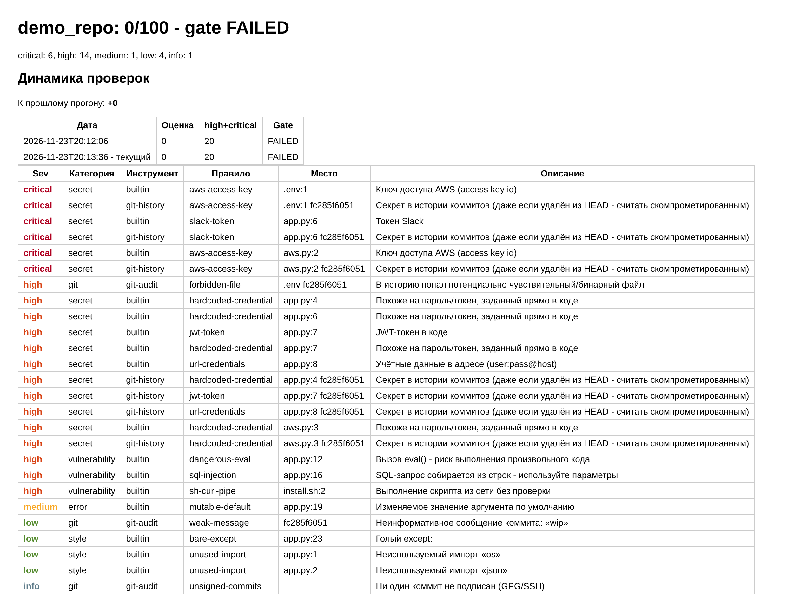

# CodeAudit — local code-quality pipeline and Git repository audit

A single offline tool that scans source code (bugs, vulnerabilities, code style, secrets)
and audits the full Git commit history. It scores a repository from 0 to 100, evaluates the
quality gate, and writes JSON, Markdown, and HTML reports. Built for the MO-1 course project:
automation of code-quality analysis and Git auditing without mandatory third-party packages.


HTML report for the built-in demo repository:



## Quick start

Requirements: Python 3.11+ and Git. No pip dependencies or network access are required.

```
python3 run.py            # interactive menu (Windows: run.bat)
python3 run_demo.py       # self-contained demo: creates a repo with planted defects and audits it
python3 pipeline.py /path/to/repo --out report --config config.toml
```

## Demonstration output

```
[..] builtin-python: работаю...
[ok] builtin-python: 3
[..] builtin-secrets: работаю...
[ok] builtin-secrets: 9
[..] git-audit: работаю...
  ... git-audit: в истории 1 коммитов
  ... git-audit: сканирую патчи всей истории на секреты
[ok] git-audit: 10
Оценка 0/100, high+critical=20, gate=FAILED; отчёты: demo_out/
Готово за 0.0 с
```

Console messages are intentionally in Russian (the course deliverable is localized);
findings, reports and JSON are fully parseable. Stage markers: `[..]` running, `[ok]` done,
`[--]` skipped (external tool not installed), `[!!]` stage error (does not stop the pipeline).

## Analysis scope

| Stage | External tool (optional) | Built-in implementation |
|---|---|---|
| Errors | ruff (F, B, E9) | syntax via `ast`, mutable default arguments, assert-on-tuple, redefined functions |
| Vulnerabilities | bandit, semgrep (local rules) | eval/exec, shell=True, SQL injection, pickle/yaml.load, weak hashes, disabled TLS, debug mode; regex rules for JS/TS, C/C++, PHP, Java, shell |
| Style | ruff (E, W, N, C90), shellcheck | unused and `*` imports, complexity, function/line length, naming, None comparison, trailing whitespace, EOF, indentation, TODO |
| Secrets | gitleaks | 11 secret kinds (see below) |
| Git history | gitleaks | secrets in every commit (including deleted), forbidden files, large blobs, huge commits, weak messages, future dates, unsigned commits, suspicious authors |

Secret detector covers 11 kinds: AWS access and secret keys, private keys, GitHub tokens,
Google API keys, Stripe keys, Slack tokens, Telegram bot tokens, JWT tokens,
credentials in URLs (`user:pass@host`), and passwords/tokens hardcoded in code.

## Additional capabilities

- **Progress reporting.** Stage status and elapsed time are displayed in the terminal.
  For large repositories, a file counter is written to stderr every 5,000 files, preserving
  machine-readable stdout. Total elapsed time is reported when analysis completes.
- **Per-repository reports.** The interactive menu suggests a stable, separate report folder
  per repository and lets the user choose another path; repeated scans retain that folder's history.
- **Interactive HTML report.** Search and filter findings by severity, category, and status; view
  concise remediation guidance for common rules. No network or browser extensions are required.
- **Environment diagnostics.** Menu item 5 checks Python, Git, configuration validity, write access, local
  Semgrep rules, and availability of optional analyzers.
- **Auditable finding suppressions.** Optional `.codeaudit-suppressions.toml` entries require a rule,
  repository-relative file, rationale, and expiry date. Active suppressions remain visible in all
  reports but do not affect score/gate; expired entries stop suppressing automatically.
- **Scan cache.** Hashes for all files, including clean files, are stored in
  `.scan_cache.json`; unchanged-file results are reused. The cache is invalidated when
  configuration or analyzer code changes; disable with `--no-cache`.
- **Run history.** Every run appends a line to `history.jsonl`; reports include a
  "Run history" section with score, high+critical count and gate verdict per run,
  plus the delta against the previous run.
- **Fault isolation.** A failing stage never stops the pipeline, but an incomplete scan
  fails the gate (`scan_complete: false`, exit code 1). Invalid configuration exits with
  code 2.
- **Consistent file filters.** `scan.exclude_dirs` and `scan.max_file_kb` apply to built-in
  checks, Ruff, Bandit, Semgrep, and ShellCheck. Gitleaks receives Git-history path
  exclusions and a whole-megabyte file-size limit (minimum 1 MB).
- **Module layout.** `codeaudit/` contains configuration, scanners, cache, Git audit,
  reporting, and shared types; `pipeline.py` remains the CLI entry point.

## Scoring and quality gate

`score = max(0, 100 - sum(weights))` with weights: info 0, low 1, medium 3, high 8, critical 20.
The gate is passed when high+critical count ≤ `gate.max_high` and score ≥ `gate.min_score`
(both thresholds live in `config.toml`). Exit code 0 = gate passed, 1 = failed, 2 = usage error.

## Experimental evaluation

`bench/bench.py` generates repositories with known planted defects (21 code defect types and
5 Git-history defect types), runs the pipeline and compares found (rule, file) pairs against
the ground truth: precision, recall, F1, false positives on clean repositories, quality-gate
accuracy and runtime. Full tables: [bench/results.md](bench/results.md).

30 defective repositories, 6 clean controls (including labeled safe parameterized SQL and safe
command-argument examples), 210 planted defect pairs:

| Category | TP | FP | FN | Precision | Recall | F1 |
|---|---|---|---|---|---|---|
| error | 15 | 0 | 0 | 1.00 | 1.00 | 1.00 |
| git | 48 | 0 | 0 | 1.00 | 1.00 | 1.00 |
| secret | 19 | 0 | 0 | 1.00 | 1.00 | 1.00 |
| style | 65 | 0 | 0 | 1.00 | 1.00 | 1.00 |
| vulnerability | 63 | 0 | 0 | 1.00 | 1.00 | 1.00 |
| **total** | 210 | 0 | 0 | 1.00 | 1.00 | 1.00 |

- False positives on clean repositories: 0
- Correct quality-gate decisions: 36/36 (100%)
- Average analysis time per repository: 0.57 s (max 1.28 s)
- Run the project tests with `python3 -m unittest discover -s tests -v`.

The checked-in benchmark results are from a previous run. Re-run `bench/bench.py`
after code changes to refresh the figures and verify the current version.

### Limitations

- The benchmark is synthetic: defects were planted by the authors of the rules. Therefore,
  F1 = 1.00 describes results on the defined scenarios; it does not establish performance
  on independent real-world projects. Clean controls broaden near-miss coverage but are also
  authored test data.
- External tools (ruff, bandit, semgrep, gitleaks, shellcheck) were not installed in the
  development environment; optional integration tests now run automatically when a tool is
  installed and otherwise skip. Verify locally with `pip install ruff bandit semgrep`.
- Deep AST analysis is Python-only; other languages use regex rules (possible false
  positives and misses), so semgrep and native linters matter for them.
- No taint/data-flow analysis: the rules flag dangerous constructs, not proven exploitability.
- Files larger than `max_file_kb` (1 MB) are skipped in the working-tree scan.

## Documentation

Course project documentation is in Russian: [README.md](README.md) (primary) and
[ЗАПУСК.md](ЗАПУСК.md) (step-by-step quick-start guide).
